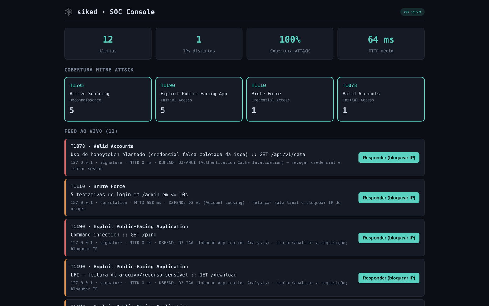

# 🕸️ siked

[](https://github.com/MarcoRodrigues00/siked/actions/workflows/ci.yml)
[](https://github.com/MarcoRodrigues00/siked/actions/workflows/security-gates.yml)

> *"Achou que era um alvo fácil? Sike. Você caiu na armadilha."*

`siked` é um **app web real e seguro** que expõe, de propósito, **iscas invisíveis** (honeypots de baixa interação e honeytokens). Usuário legítimo nunca chega numa isca, então todo toque nelas é atividade adversária. Cada evento é **capturado → normalizado → correlacionado por regras determinísticas → mapeado para MITRE ATT&CK → exibido num dashboard ao vivo (WebSocket)**. O mesmo repositório roda um **pipeline DevSecOps** com gates de segurança em todo push e pull request.

**Em uma frase:** construo um app seguro, automatizo a segurança no pipeline e detecto quem tenta atacar, em tempo real. Blue Team e DevSecOps, meio a meio.

O `d` do nome é de *daemon* (`sshd`, `httpd`): `siked` é o processo que escuta quem bate na porta errada.



*Console do SOC durante uma execução local do gerador de tráfego: 12 alertas em 4 técnicas ATT&CK, cada um com a contramedida D3FEND sugerida.*

## Arquitetura (multi-serviço, contida por rede)

```
┌──────── siked_edge (exposta na demo) ────────┐        ┌──── siked_mgmt ────┐
│  app (real seguro)   deception (iscas)        │        │  dashboard (UI SOC) │
└───────────────┬──────────────────────────────┘        └──────────▲──────────┘
                │ POST /events (único canal, autenticado)           │ WS push
┌───────────────▼───────── siked_core (internal: sem egress) ───────┴──────────┐
│  ingest → [Redis bus] → detection → dashboard    +  redis   +  ollama(opt-in)  │
│  store: JSONL append-only (SHA-256 encadeado)  +  índice SQLite                │
└───────────────────────────────────────────────────────────────────────────────┘
```

- **Isolamento:** a rede `siked_core` é `internal: true`, sem rota para a internet. O edge só fala com o core por um canal (`POST /events`) autenticado por token, comparado em tempo constante. Ver [`docs/CONTAINMENT.md`](docs/CONTAINMENT.md).
- **Custódia:** cada evento entra num JSONL append-only com hash SHA-256 encadeado. Adulterar uma linha quebra a cadeia, e `/custody/verify` aponta onde.
- **Detecção determinística:** assinaturas declarativas em YAML (estilo Sigma/Suricata) e correlação com janela de tempo. A IA, quando ligada, só enriquece o alerta; nunca decide.
- **Containers endurecidos:** todos os serviços rodam como usuário não-root, os expostos na borda (app e iscas) e o redis têm filesystem somente leitura, há HEALTHCHECK nos serviços de longa duração e as imagens de runtime usam Node 22 LTS sem npm nem devDependencies.

Decisões e trade-offs em [`docs/adr/`](docs/adr/README.md).

## O que já funciona

| Sprint | Entrega | Situação |
|---|---|---|
| 0 | App seguro (Helmet, Zod, rate limit, body cap, erros sem stack) e contenção de rede testada | ✅ |
| 1 | Iscas (`/admin`, `/.env`, `/api/v1/keys`, `/backup.zip`, `/phpmyadmin` e qualquer rota inexistente), honeytokens, ingest com sanitização de segredos e custódia SHA-256 | ✅ |
| 2 | Motor de detecção (assinaturas e correlação), ATT&CK, dashboard WebSocket e gerador de tráfego | ✅ |
| 3 | Pipeline CI e gates de segurança | ✅ |
| 3 | 10 vulnerabilidades plantadas para provar que cada gate pega a sua | ⏳ |
| 4 | Resposta simulada (D3FEND/SOAR), enriquecimento por IA local e matriz de cobertura | ⏳ |

Técnicas detectadas hoje: **T1595** Active Scanning, **T1190** Exploit Public-Facing Application (SQLi, path traversal, LFI, command injection), **T1110** Brute Force e **T1078** Valid Accounts (uso de honeytoken). O MTTD é medido em cada alerta.

## Pipeline DevSecOps

Dois workflows rodam em todo push e pull request. Qualquer gate vermelho falha o pipeline.

| Gate | Ferramenta | O que barra | Configuração |
|---|---|---|---|
| Testes | Vitest + supertest | regressão funcional e de segurança (headers, 413, 400, erro sem stack) | [`ci.yml`](.github/workflows/ci.yml) |
| Segredos | Gitleaks | credencial no código ou no histórico inteiro do git | [`security/gitleaks`](security/gitleaks/gitleaks.toml) |
| SAST | Semgrep | OWASP Top 10, regras JS/TS/Node e 4 regras próprias (stack trace na resposta, SQL montado com template, `exec`, `eval`) | [`security/semgrep`](security/semgrep/siked.yml) |
| Dependências | Trivy fs + `npm audit` | CVE high/critical com correção disponível | [`security-gates.yml`](.github/workflows/security-gates.yml) |
| Imagens | Trivy image | CVE high/critical nas 6 imagens dos serviços | [`security-gates.yml`](.github/workflows/security-gates.yml) |
| Dockerfile e CI | Hadolint + Checkov | Dockerfile fora das boas práticas e workflow inseguro | [`security/hadolint`](security/hadolint/hadolint.yaml), [`security/checkov`](security/checkov/config.yaml) |

O próprio pipeline segue o que cobra: actions fixadas por SHA, ferramentas em versão fixa com checksum SHA-256 conferido, `permissions: contents: read` e checkout sem credenciais persistidas. Quando um gate falha, cada achado vira uma anotação no PR com arquivo e linha.

No Gitleaks, só ficam liberados, por regex exata, o honeytoken falso e um JWT sintético usado num teste. Uma chave AWS real com o mesmo formato continua falhando o build. As exceções do Semgrep e do Checkov ficam no código, com justificativa.

## Testes

69 testes automatizados:

| Serviço | Testes | O que cobrem |
|---|---|---|
| `ingest` | 23 | normalização, sanitização de segredos/PII, cadeia de custódia e endpoint autenticado |
| `detection` | 14 | assinaturas, correlação e invariantes do motor |
| `deception` | 13 | iscas, honeytokens e emissão de eventos |
| `app` | 9 | headers de segurança, limite de body, validação e erros sem stack |
| `traffic-generator` | 6 | cenários e guardrail de alvo |
| `shared` | 4 | schema do evento canônico |

```bash
cd ingest && npm ci && npm test     # mesmo comando em cada serviço
```

## Como subir (demo)

```bash
cp .env.example .env                          # troque o INGEST_TOKEN
docker compose up --build                     # sobe app, iscas, ingest, detection, dashboard e redis
docker compose --profile demo up traffic-generator   # dispara os cenários de ataque sintético
# console do SOC: http://localhost:8080
```

## Frameworks citados

- **MITRE ATT&CK:** cada detecção mapeada para tática e técnica (T1595, T1190, T1110, T1078).
- **MITRE Engage:** *adversary engagement* e deception (expose → elicit → collect).
- **MITRE D3FEND:** contramedida sugerida em cada alerta, amarrando detecção a resposta.
- **OWASP:** Honeypot Project e Top 10.
- **NIST SP 800-53 Rev. 5:** controles SI-4, RA-5, CM-6 e família AU.
- **The Honeynet Project:** referência clássica de honeypots.

## Postura ética

Só iscas de baixa interação. Nada fica exposto à internet pública, nenhuma isca carrega segredo real e o gerador de tráfego tem um guardrail que só permite atacar o `siked` local isolado.

## Documentação

[ADRs](docs/adr/README.md) · [Contenção](docs/CONTAINMENT.md) · [Sprints](docs/SPRINTS.md) · [Plano de arquitetura](docs/PLANO.md)
